# Práctica 2: Movimiento

## Situación 1

El cubo tiene Rigidbody, por lo que la gravedad le afecta y detecta colisiones.
La esfera y el plano no tienen Rigidbody, por lo que no reciben fuerzas físicas ni caen.

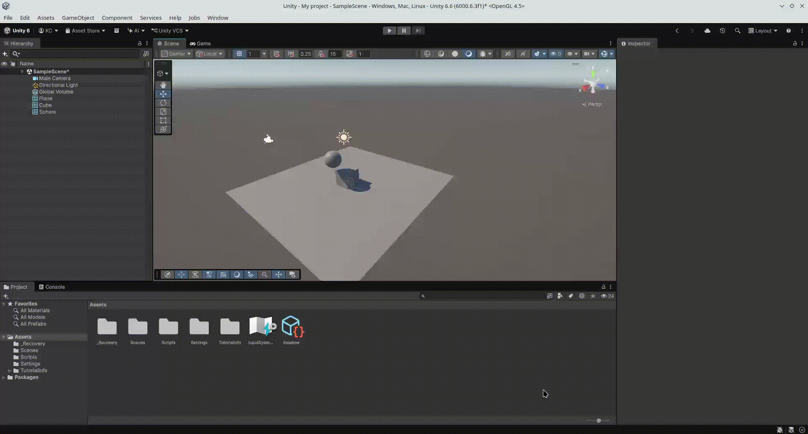

## Situación 2

Al tener Rigidbody tanto el cubo como la esfera, la gravedad actúa sobre ambos.
Sus colisionadores evitan que se traspasen entre sí y con el plano estático.
Como la esfera no tiene ningún material físico asignado, por defecto no tiene fricción.
Por eso no se para al chocarse contra el plano, y este tampoco le aplica ninguna fuerza de fricción.

## Situación 3

En este ejemplo, como la esfera es cinemática, no se le aplican las fuerzas físicas, ya que se supone
que los objetos cinemáticos son controlados por código. Por eso se queda colgando en el aire.

## Situación 4

Todos los objetos se caen, ya que todos tienen Rigidbody y a todos se les aplican las mismas reglas
físicas, incluyendo la gravedad.

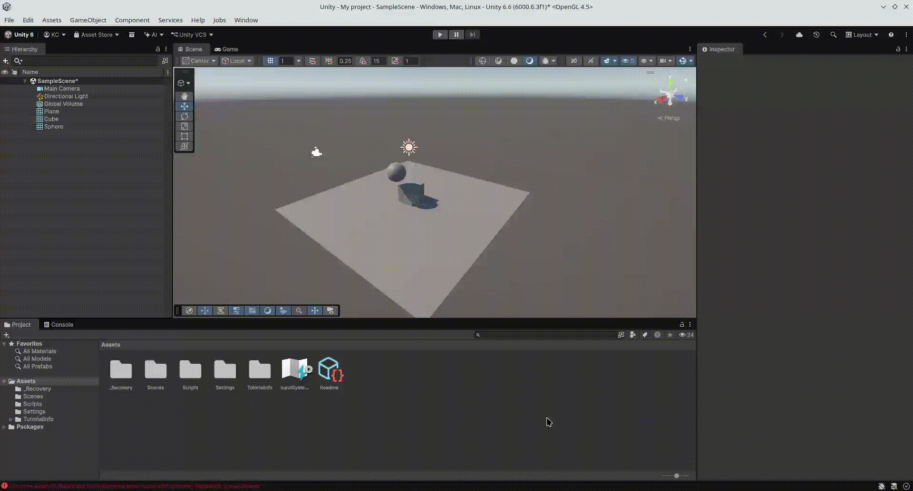

## Situación 5

Como ahora el plano es un objeto cinemático, no le afecta la gravedad. La esfera choca contra el cubo
y por la masa que tiene la esfera el cubo se mueve un poco.

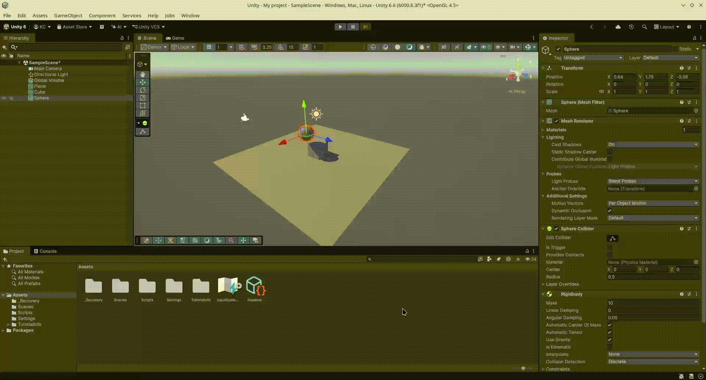

## Situación 6

Es la misma situación que en el apartado anterior, pero esta vez la esfera es más pesada. El cubo se mueve
más ya que la fuerza del impacto es mayor según la segund ley de Newton.

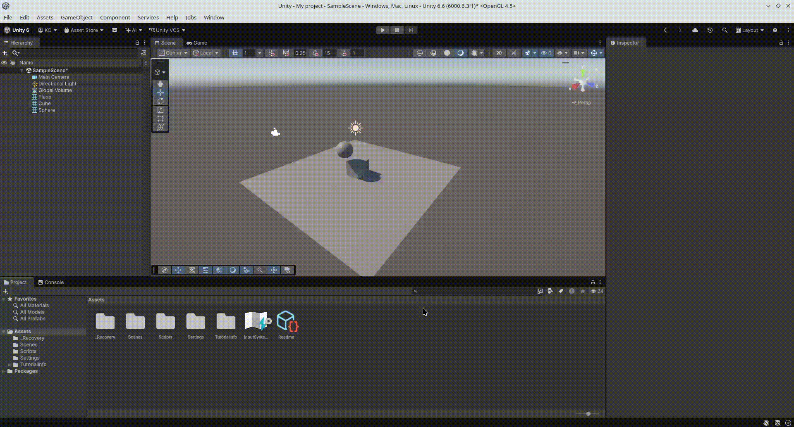

## Situación 7

En este caso el material físico de la esfera permite que se le aplique la fuerza de fricción.
Cuando la esfera se cae y empieza a rodarse, se para por la fuerza de fricción.

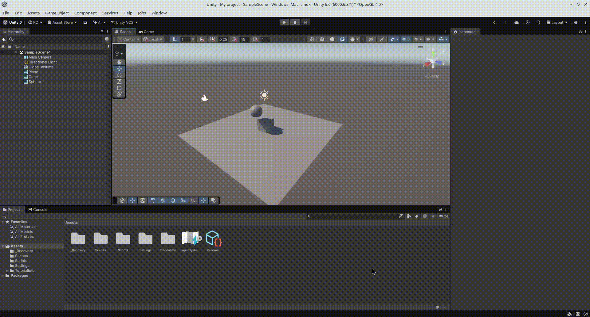

## Situación 8

El enunciado no me pareció muy claro. Supuse que la frase "...la esfera no es física..."
significa que la esfera es un objeto cinemático. No vi ninguna otra interpretación, ya que
en la siguiente frase ponía que todos los objetos tienen Rigidbody. Por tanto, se observa el mismo efecto
que en la situación 3.

## Situación 9

Como la esfera es un trigger, las colisiones no se registran sino se detectan a través de callbacks
OnTriggerEnter, OnTriggerExit y OnTriggerStay. Por eso la esfera pudo atravesar el resto de los objetos.

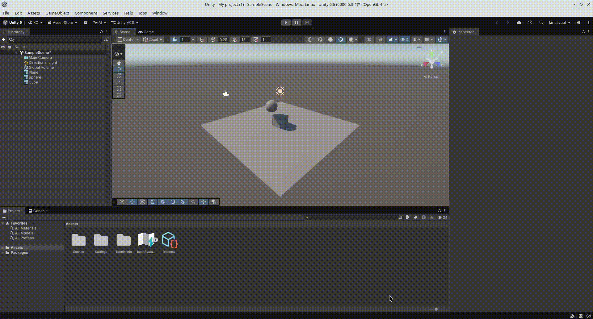

## Ejercicio 1

Para la realización de este ejercicio he seguido el manual de [Unity](https://docs.unity3d.com/6000.6/Documentation/ScriptReference/Rigidbody.MovePosition.html).
La cápsula es un objeto cinemático. Por lo tanto, se mantiene el control total sobre el personaje a través de su script.

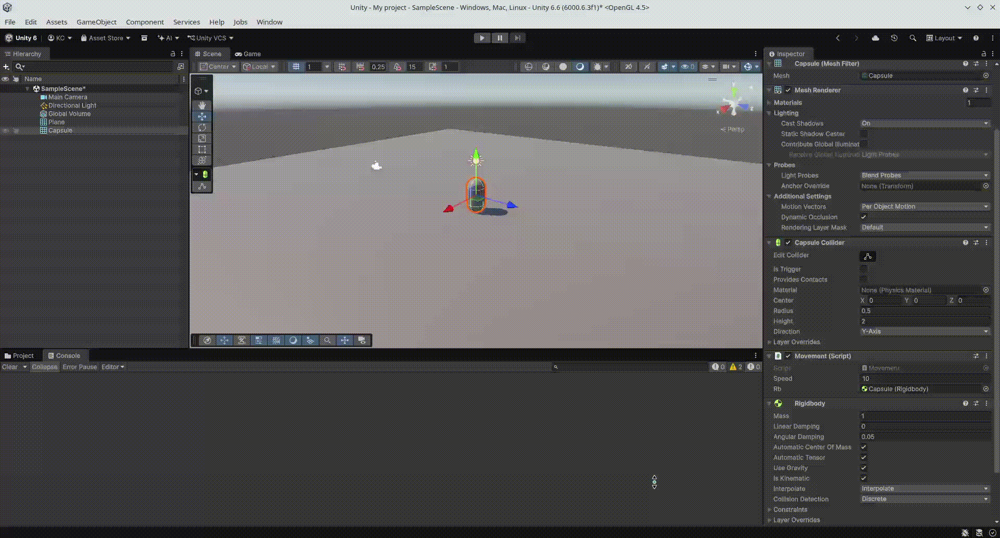

## Ejercicio 2

Reutilicé el script del ejercicio anterior para el personaje.
Para los cubos he creado una componente que detecta colisiones a través de OnCollisionEnter y
cambia el color utilizando el Renderer.

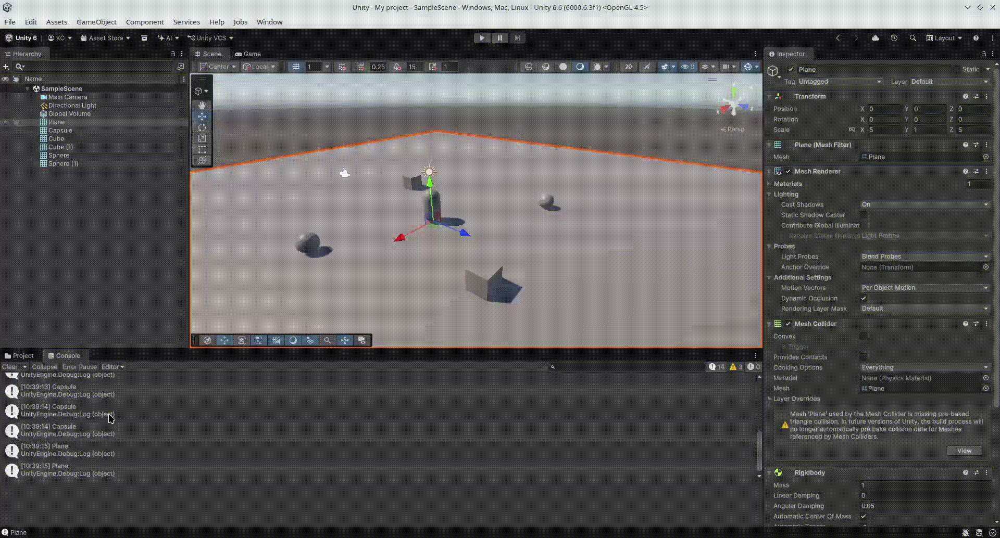

## Ejercicio 3

He definido materiales nuevos para este ejercicio para que se viera mejor el comportamiento.
Las dos zonas funcionan con Collider y `IsTrigger = true`.

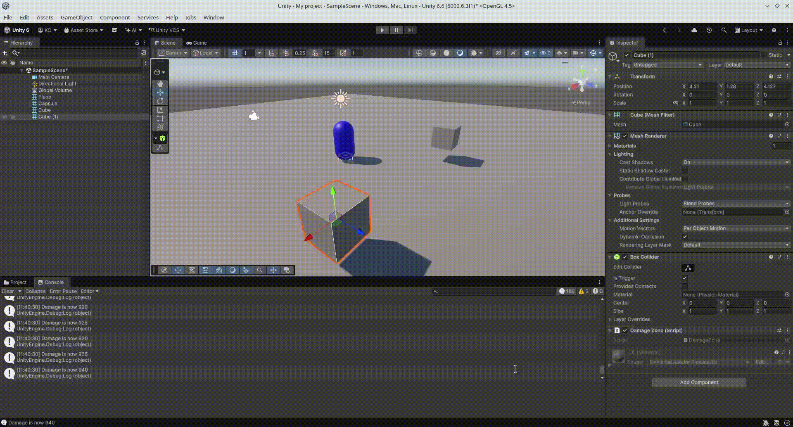

## Ejercicio 4

Primero he creado 4 capas nuevas: Player, Ground, Collectible y Enemy.

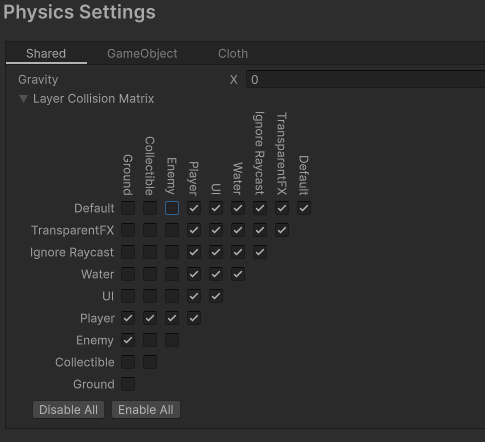

Luego asigné a mis entidades las correspondientes capas y implementé la lógica deseada.
Cuando el enemigo toca la "moneda", no ocurre nada. Sin embargo, cuando lo hace el jugador, se destruye.

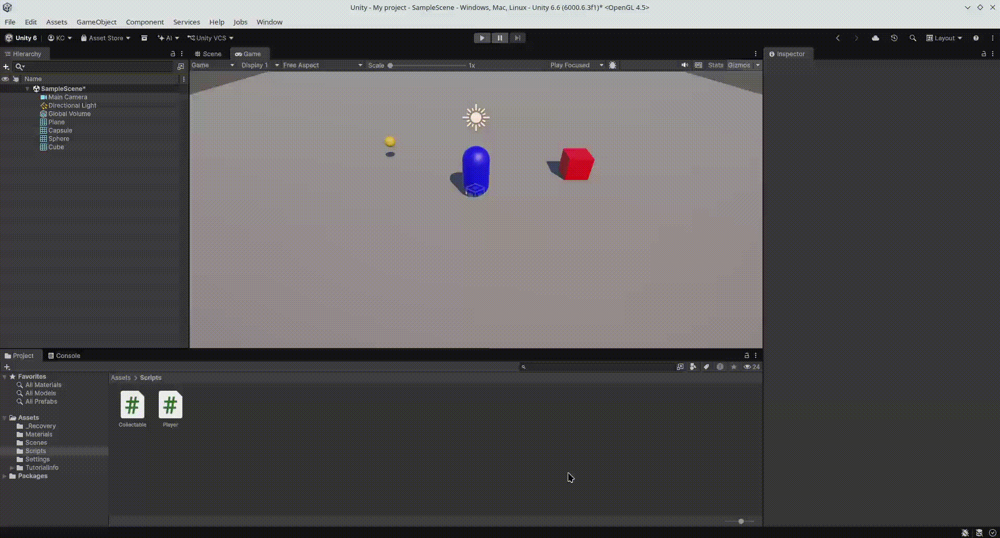

## Ejercicio 5

He definido 3 materiales físicos con propiedades diferentes y he creado un script común que lanza
los objetos en al aire al presionar la tecla X.

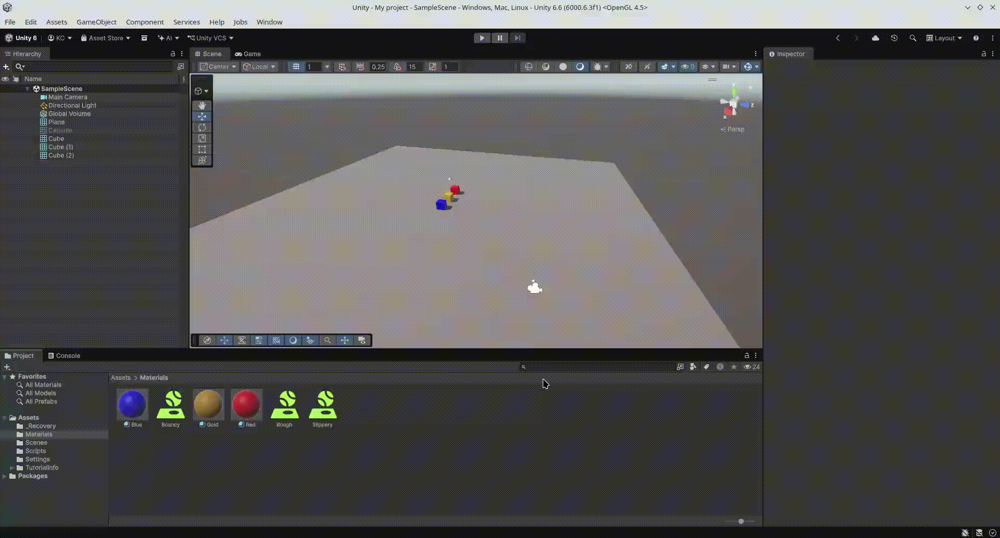

## Ejercicio 6

Como para este ejercicio ningún objeto puede ser Rigidbody, tuve que calcular la colisión a mano.
Como todos los objetos están alineados, solo tuve que tener en cuenta que la posición de la esfera + el radio
de la esfera sean > que la posición del cubo + la mitad de la longitud de una de sus caras.

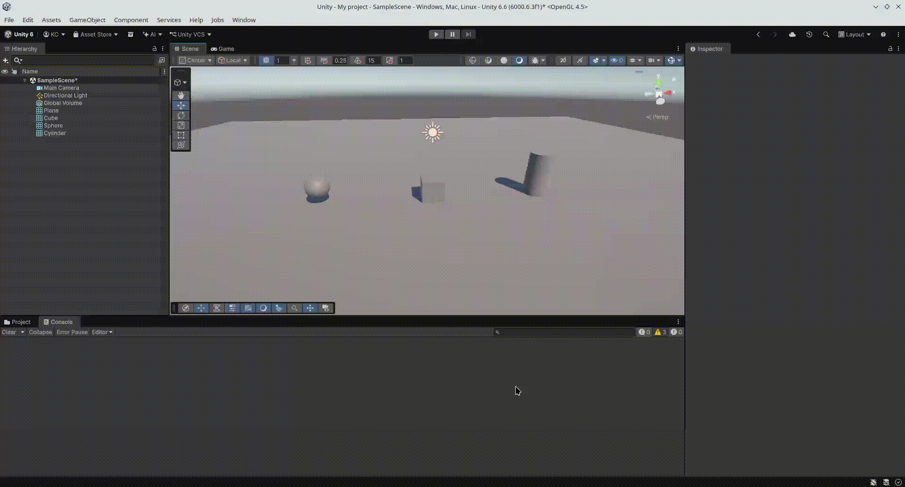
